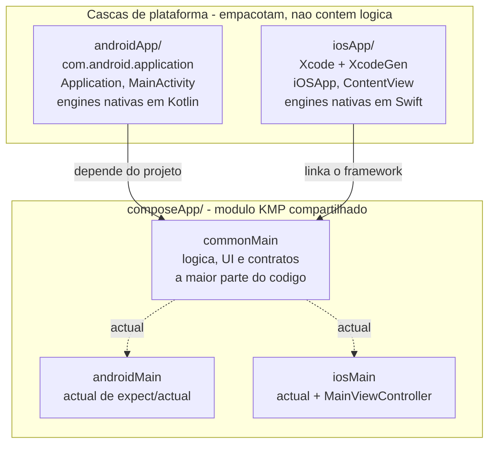
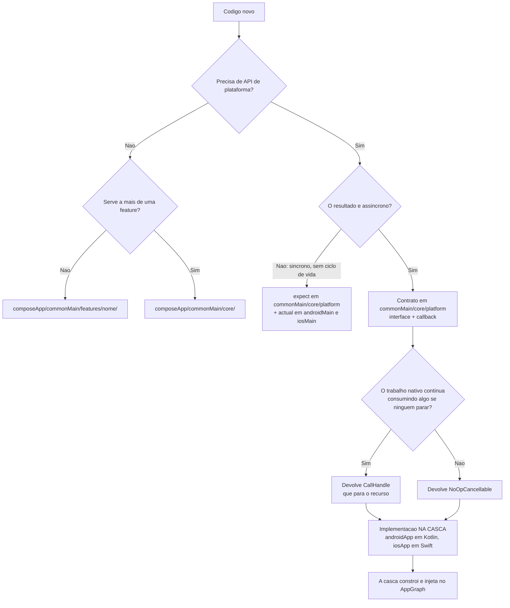
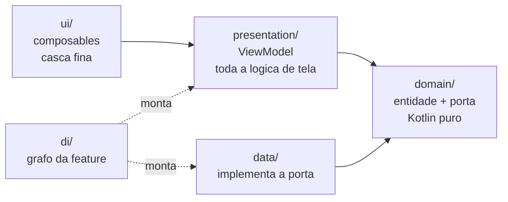
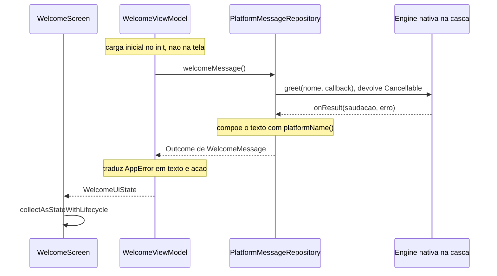

# SDD 03 — Mapa de código: onde cada coisa fica

Este documento responde a uma pergunta só: **"acabei de escrever isto, onde
coloco?"**. O *porquê* de cada regra está no SDD 02 e nos ADRs — aqui é o mapa.

## Topologia: três lugares

O erro de leitura mais comum é parear `androidMain` com `iosApp`. **Eles não são
pares.** Os pares corretos são:

| Papel | Android | iOS |
| --- | --- | --- |
| Source set do módulo compartilhado | `composeApp/androidMain` | `composeApp/iosMain` |
| Módulo de app (casca) | `androidApp/` | `iosApp/` |

`androidMain` é **Kotlin específico de Android que faz parte da biblioteca
compartilhada** — compila dentro do `composeApp` e vai junto no artefato que o
`androidApp` consome. `androidApp` é um **módulo Gradle separado que produz o
APK**; existe porque o AGP 9 proíbe um módulo KMP de ser
`com.android.application`.

O iOS não tem módulo Gradle equivalente porque o `iosApp` é um projeto Xcode —
mas o papel é o mesmo.

## Assimetrias entre as plataformas: quais são inevitáveis

Nem tudo tem espelho exato. Vale saber o que é imposição da ferramenta e o que
foi decisão:

| O quê | Android | iOS | Por quê |
| --- | --- | --- | --- |
| `actual` de `expect/actual` | `composeApp/androidMain` | `composeApp/iosMain` | O compilador exige o `actual` no source set do alvo. |
| Entry point Compose | `androidApp/MainActivity` | `composeApp/iosMain/MainViewController` | Um precisa estar no manifesto; o outro precisa ser exportado no framework, logo é Kotlin. |
| Implementação de engine nativa | `androidApp/` (Kotlin) | `iosApp/` (Swift) | No iOS não há escolha: Swift só existe no projeto Xcode. Manter o Android na casca é **decisão** — ver abaixo. |

O `AndroidGreetingEngine` poderia estar em `androidMain`, já que é Kotlin. Fica
na casca por três motivos: simetria com o iOS; o SDK vendor (Imou/Tuya) ficar
fora do módulo que também gera o framework iOS; e a implementação viver junto de
quem a constrói (ADR 0003).

## Onde ponho isto?

### Quando o padrão de engine se aplica — e quando não

O padrão tem **dois critérios independentes**, e confundi-los é o que faz ele
parecer pesado:

1. **Interface + callback** — necessário quando o resultado é **assíncrono**.
   Não é escolha: o Swift não consegue implementar uma função `suspend` do
   Kotlin, então o contrato tem de ser callback (ADR 0006).
2. **`Cancellable` de verdade** — necessário quando o trabalho nativo
   **continua consumindo algo** se ninguém o parar: rádio ligado, câmera aberta,
   sessão de SDK viva, requisição em voo, timer rodando.

O segundo critério é o que decide se há trabalho real a fazer. Sem ele, o
handle existe só para o contrato ficar uniforme — e aí é `NoOpCancellable`.

| Cenário | Precisa de engine? | Cancelamento carrega peso? |
| --- | --- | --- |
| Versão do SO, locale, nome do aparelho | Não — `expect/actual` | — |
| Scan BLE de netconfig | Sim | **Sim** — sem `cancel`, o rádio segue varrendo depois que o usuário sai |
| Preview/stream de câmera | Sim | **Sim** — sessão de vídeo aberta |
| Leitura de QR code | Sim | **Sim** — câmera aberta |
| Consulta de status via SDK (rede) | Sim | **Sim** — requisição em voo |
| Valor já em cache do SDK, devolvido por callback | Sim | Não — `NoOpCancellable` |

O caso da `GreetingEngine` do template é o penúltimo tipo: assíncrona, mas sem
recurso para desligar. Ela usa `CallHandle` mesmo assim porque é **exemplo do
formato** — não porque a saudação precise ser cancelada.

Em forma de tabela, para consulta rápida:

| Quero adicionar… | Vai em |
| --- | --- |
| Tela, ViewModel, entidade, repositório de uma feature | `composeApp/commonMain/features/<nome>/` |
| Algo usado por duas ou mais features | `composeApp/commonMain/core/` |
| Versão do SO, locale, dado de plataforma síncrono | `expect` em `core/platform/` + `actual` nos dois source sets |
| Contrato de SDK nativo (câmera, BLE, IoT) | `commonMain/core/platform/` — interface + `Cancellable` |
| Implementação desse SDK | `androidApp/` (Kotlin) e `iosApp/` (Swift) |
| Registro de uma feature no grafo | `commonMain/features/<nome>/di/` + uma linha no `AppGraph` |
| Ícone, manifesto, permissão, `Info.plist` | a casca correspondente |
| Regra de quality gate, target, versão de lib | `build-logic/` ou `gradle/libs.versions.toml` |

## Dentro de uma feature

Sem camada de use case: o ViewModel depende da **porta**, não da implementação
(ADR 0005). As setas são as regras de dependência do SDD 02 — `domain` não
aponta para ninguém, e nenhuma feature aponta para outra feature.

## Um caminho de ponta a ponta

Para ver os saltos e o que cada um faz:

O contrato da engine é o mesmo nas duas plataformas; o que muda é quem o
implementa — Kotlin no `androidApp`, Swift no `iosApp`. Em `commonTest`, um Fake
substitui os dois, e é por isso que toda a lógica acima é testável sem device
nem simulador.

## Quando isto virar módulos Gradle

O caminho de modularização está no SDD 02. O que importa para este mapa: a regra
"feature não importa de feature" é o que torna a extração um **mover pasta**. Se
ela for violada, este mapa deixa de valer antes do previsto.
