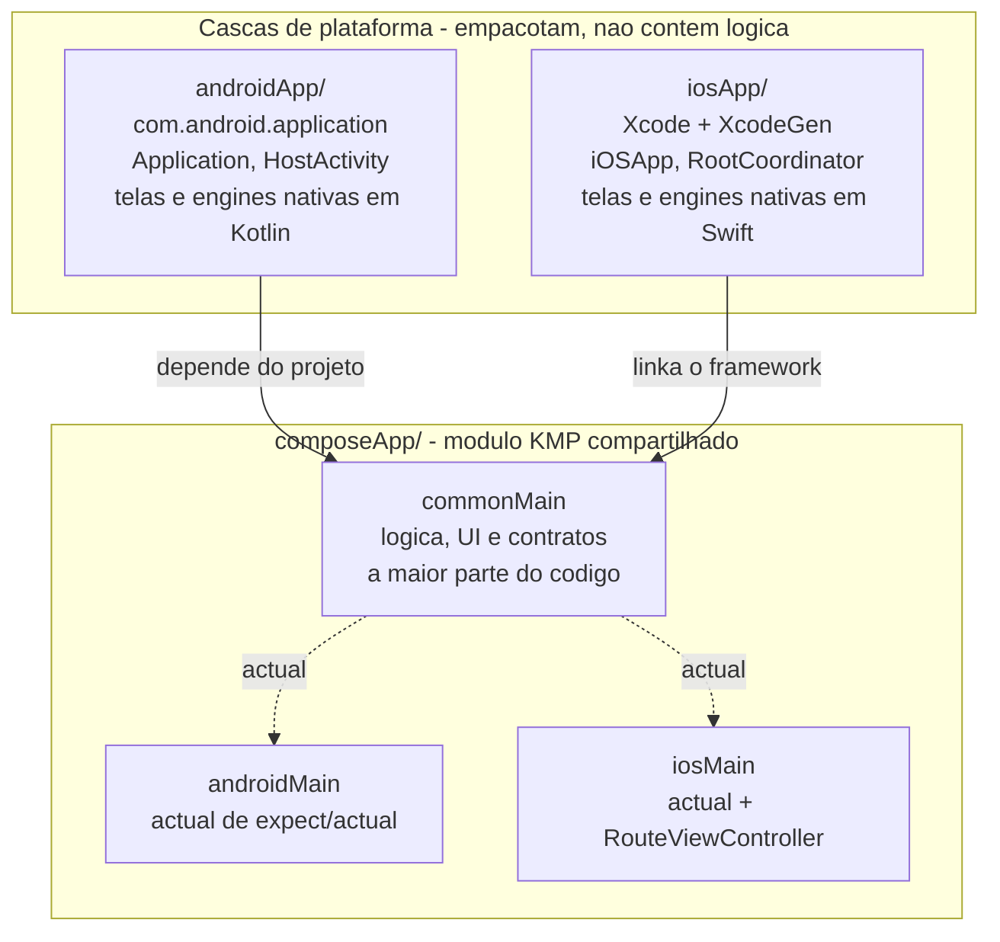
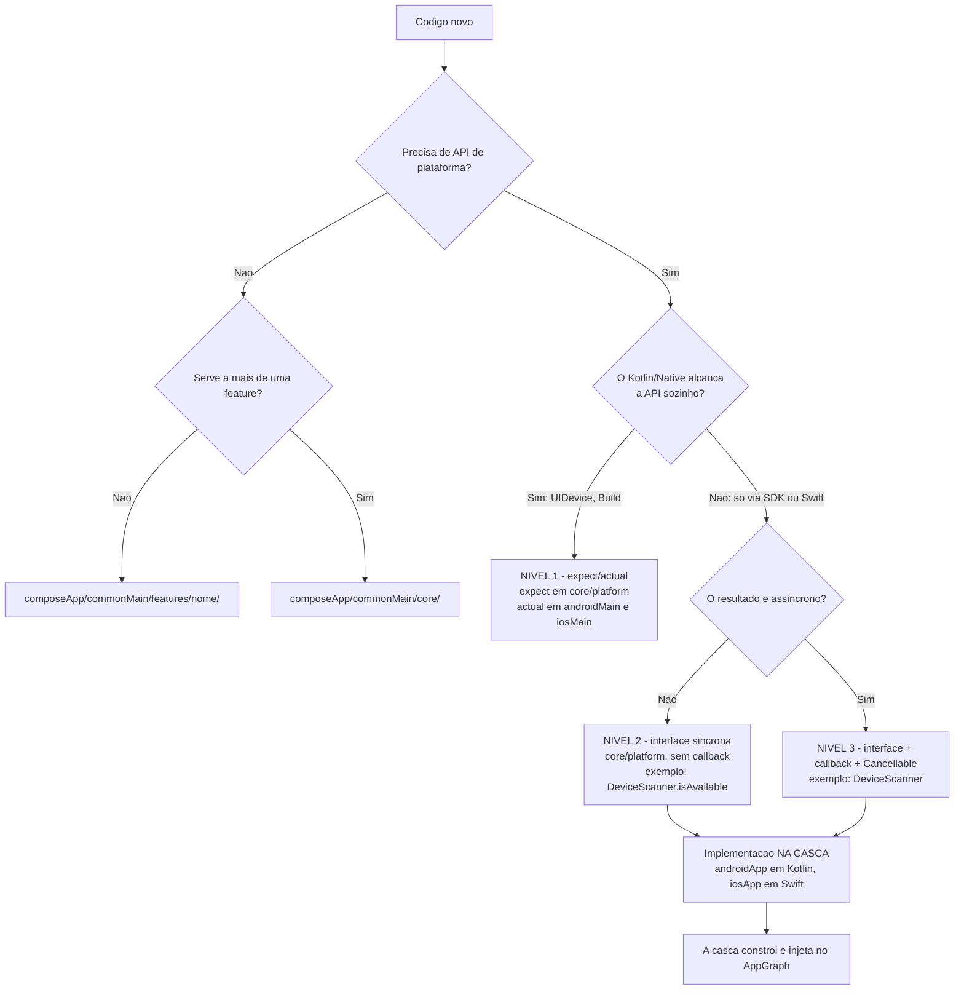
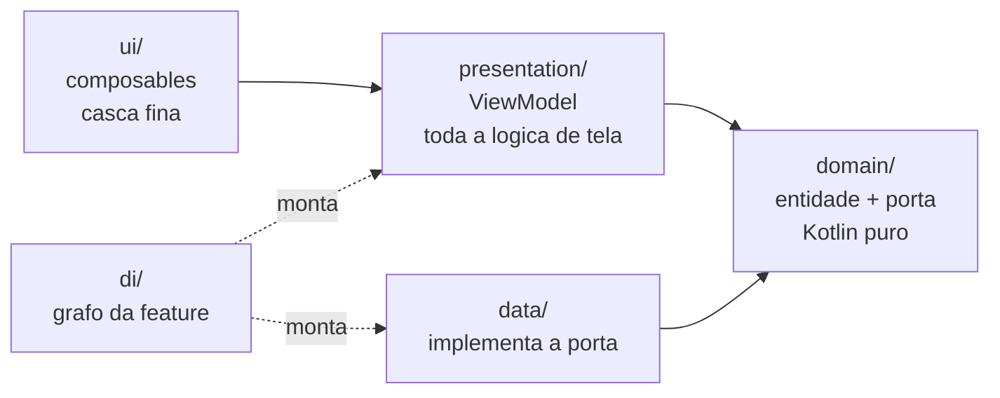
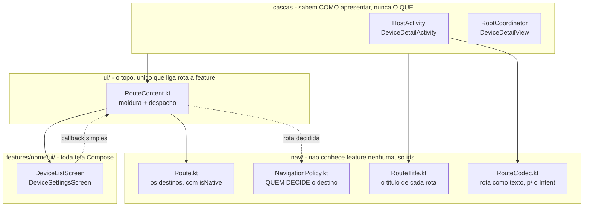
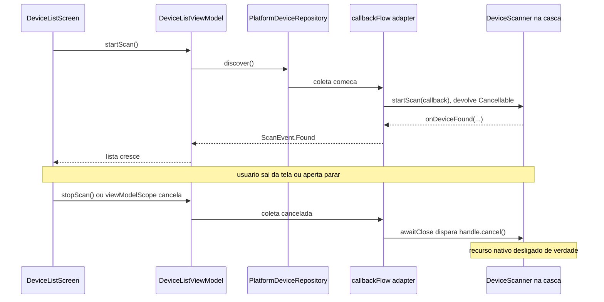

# SDD 03 — Mapa de código: onde cada coisa fica

Este documento responde a uma pergunta só: **"acabei de escrever isto, onde
coloco?"**. O *porquê* de cada regra está no SDD 02 e nos ADRs — aqui é o mapa.

## Topologia: três lugares

O erro de leitura mais comum é parear `androidMain` com `iosApp`. **Eles não são
pares.** Os pares corretos são:

| Papel | Android | iOS |
| --- | --- | --- |
| Source set do módulo compartilhado | `composeApp/androidMain` | `composeApp/iosMain` |
| Módulo de app (casca) | `androidApp/` | `iosApp/` |

`androidMain` é **Kotlin específico de Android que faz parte da biblioteca
compartilhada** — compila dentro do `composeApp` e vai junto no artefato que o
`androidApp` consome. `androidApp` é um **módulo Gradle separado que produz o
APK**; existe porque o AGP 9 proíbe um módulo KMP de ser
`com.android.application`.

O iOS não tem módulo Gradle equivalente porque o `iosApp` é um projeto Xcode —
mas o papel é o mesmo.

## Assimetrias entre as plataformas: quais são inevitáveis

Nem tudo tem espelho exato. Vale saber o que é imposição da ferramenta e o que
foi decisão:

| O quê | Android | iOS | Por quê |
| --- | --- | --- | --- |
| `actual` de `expect/actual` | `composeApp/androidMain` | `composeApp/iosMain` | O compilador exige o `actual` no source set do alvo. |
| Entry point Compose | `androidApp/HostActivity` | `composeApp/iosMain/RouteViewController` | Um precisa estar no manifesto; o outro precisa ser exportado no framework, logo é Kotlin. |
| Implementação de engine nativa | `androidApp/` (Kotlin) | `iosApp/` (Swift) | No iOS não há escolha: Swift só existe no projeto Xcode. Manter o Android na casca é **decisão** — ver abaixo. |
| Dono da pilha de navegação | pilha de Activities | `UINavigationController` | ADR 0007: a pilha é a da plataforma. Cada destino Compose é uma raiz própria. |
| Tela 100% nativa | `androidApp/` (`View`) | `iosApp/` (SwiftUI) | Ela **é** da plataforma — é o caso que o ADR 0007 existe para suportar. |

O `AndroidDeviceScanner` poderia estar em `androidMain`, já que é Kotlin. Fica
na casca por três motivos: simetria com o iOS; o SDK vendor (Imou/Tuya) ficar
fora do módulo que também gera o framework iOS; e a implementação viver junto de
quem a constrói (ADR 0003).

## Onde ponho isto?

### Os três níveis da fronteira nativa

Confundir os níveis é o que faz o padrão parecer pesado. Cada um tem um exemplo
vivo no template:

| Nível | Quando | Exemplo aqui | Custo |
| --- | --- | --- | --- |
| **1. `expect/actual`** | O Kotlin/Native já alcança a API (`UIDevice`, `Build`) | `platformName()` | Uma função por plataforma |
| **2. Interface síncrona** | Só o SDK/Swift alcança, mas responde na hora | `DeviceScanner.isAvailable` | Interface + impl na casca |
| **3. Interface + callback + `Cancellable`** | Demora **e** segura recurso enquanto roda | `DeviceScanner` | O contrato completo |

O nível 2 **não tem engine dedicada** no template: o `isAvailable` do
`DeviceScanner` é exatamente ele — uma pergunta ao SDK que responde na hora, sem
callback e sem nada a cancelar. Uma engine só-síncrona seria a mesma interface
sem o `startScan`.

Duas perguntas resolvem qualquer caso:

1. **O Kotlin/Native alcança sozinho?** Se sim, nível 1 — não invente interface.
2. **O resultado é assíncrono?** Se não, nível 2. O Swift não consegue
   implementar uma função `suspend` do Kotlin, então assíncrono obriga callback
   (ADR 0006) — não é escolha de estilo.

E o `Cancellable` só carrega peso quando o trabalho nativo **continua consumindo
algo** se ninguém o parar:

| Cenário | Nível | Cancelamento pesa? |
| --- | --- | --- |
| Versão do SO, locale | 1 | — |
| SDK inicializado? token em cache? | 2 | — |
| Scan BLE de netconfig | 3 | **Sim** — o rádio segue varrendo |
| Preview/stream de câmera | 3 | **Sim** — sessão de vídeo aberta |
| Leitura de QR code | 3 | **Sim** — câmera aberta |
| Consulta de status via SDK (rede) | 3 | **Sim** — requisição em voo |

### O contrato de callback (nível 3)

A implementação **precisa** honrar, e o adapter depende disso:

- callbacks entregues de forma **serializada**, na main thread;
- o callback de término é chamado **no máximo uma vez**;
- depois de `cancel()`, nenhum callback é entregue.

O segundo item não é preciosismo: `resume` concorrente numa continuation é
`IllegalStateException`, e `trySend` após `close` num Flow vira evento perdido.

**Atenção ao que "main thread" significa aqui:** só a *entrega do callback*.
O trabalho de um SDK real (varredura BLE, decode de vídeo) roda nas threads do
próprio SDK — nunca na main. E dados de alta frequência (frames, áudio) **não
atravessam a fronteira**: ficam na ilha nativa (SDD 02).

Em forma de tabela, para consulta rápida:

| Quero adicionar… | Vai em |
| --- | --- |
| Tela, ViewModel, entidade, repositório de uma feature | `composeApp/commonMain/features/<nome>/` |
| **Uma tela Compose** | `features/<nome>/ui/` — **sempre**, sem exceção |
| **Um destino novo** | rota em `nav/Route.kt`, a decisão que leva a ele em `nav/NavigationPolicy.kt`, o título em `nav/RouteTitle.kt` e um ramo no `when` de `ui/RouteContent.kt` |
| **Uma tela 100% nativa** | a casca (`androidApp/`, `iosApp/`) + uma `Route` com `isNative` |
| Algo usado por duas ou mais features | `composeApp/commonMain/core/` |
| Versão do SO, locale, dado de plataforma síncrono | `expect` em `core/platform/` + `actual` nos dois source sets |
| Contrato de SDK nativo (câmera, BLE, IoT) | `commonMain/core/platform/` — interface + `Cancellable` |
| Implementação desse SDK | `androidApp/` (Kotlin) e `iosApp/` (Swift) |
| Registro de uma feature no grafo | `commonMain/features/<nome>/di/` + uma linha no `AppGraph` |
| Ícone, manifesto, permissão, `Info.plist` | a casca correspondente |
| Regra de quality gate, target, versão de lib | `build-logic/` ou `gradle/libs.versions.toml` |

## Dentro de uma feature

Sem camada de use case: o ViewModel depende da **porta**, não da implementação
(ADR 0005). As setas são as regras de dependência do SDD 02 — `domain` não
aponta para ninguém, e nenhuma feature aponta para outra feature.

## Navegação: onde mora cada peça

O porquê está no SDD 02 e no ADR 0007. Aqui é o mapa — e a regra de ouro é que
`ui/RouteContent.kt` **só faz moldura e despacho**: nenhuma tela nasce nele.

Como isso se lê na prática:

1. A tela recebe **callback simples** (`onDeviceSelected`), nunca uma rota — ela
   não conhece navegação.
2. `RouteContent` traduz o callback em destino chamando a `NavigationPolicy`.
3. A casca recebe a rota pronta e só decide **como** montar: `isNative` diz se é
   uma tela da plataforma ou mais uma raiz Compose.

| Pergunta | Resposta |
| --- | --- |
| Onde ponho uma tela Compose? | `features/<nome>/ui/` |
| Onde ponho uma tela nativa? | na casca de cada plataforma |
| Onde decido para onde ir? | `nav/NavigationPolicy.kt` — nunca na casca, nunca na tela |
| Onde ligo rota a tela? | o `when` do `ui/RouteContent.kt` |
| Onde ponho o título? | `nav/RouteTitle.kt` — as duas plataformas leem de lá |
| Como a navegação sobrevive à morte de processo? | `RouteCodec` no extra do `Intent`; o sistema restaura a task e cada host relê sua rota |
| Onde guardo o que atravessa telas? | no `AppGraph` (escopo de aplicação) — **não** na composição |

## Um caminho de ponta a ponta

Para ver os saltos e o que cada um faz:

O contrato da engine é o mesmo nas duas plataformas; o que muda é quem o
implementa — Kotlin no `androidApp`, Swift no `iosApp`. Em `commonTest`, um Fake
substitui os dois, e é por isso que toda a lógica acima é testável sem device
nem simulador.

## Quando isto virar módulos Gradle

O caminho de modularização está no SDD 02. O que importa para este mapa: a regra
"feature não importa de feature" é o que torna a extração um **mover pasta**. Se
ela for violada, este mapa deixa de valer antes do previsto.
